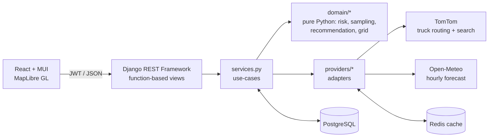

# Trucker: Weather-Aware Truck Routing

[](https://github.com/emmettfrankenstein/trucker/actions/workflows/ci.yml)

Trucker helps a driver choose the safest route. You enter an origin, a destination, a departure time and a load weight. The app then:

- gets **three truck routes** from TomTom's truck-routing API, using the truck profile and load weight;
- places a **weather checkpoint every 10, 25 or 50 miles**, works out when the truck will reach each one, and reads the forecast for **that hour**;
- classifies each checkpoint with the **risk and load rules**, and explains why it got that level;
- **recommends a route**: fewest Severe miles first, then fewest High miles, then lowest average risk, then shortest time;
- draws everything on a **map**: routes coloured by risk, checkpoints with popups, and a **0–48 h weather heatmap** with a slider and a play button.

**Live app:** https://trucker-pink.vercel.app · **API docs:** https://trucker-api-vxmt.onrender.com/api/docs/ · **Walkthrough:** _add Loom link_

---

## Architecture



The backend has three layers, and each one only depends on the layer below it:

| Layer | Where | What it does |
|---|---|---|
| **HTTP** | `trips/views.py`, `accounts/views.py`, `*/urls.py`, `*/serializers.py` | Thin function-based views (`@api_view`): validate with a serializer, call a service, serialize the result. |
| **Use-cases** | `trips/services.py` | `plan_trip()` and `build_heatmap()` coordinate the providers and the domain logic, then save the results. |
| **Domain** | `trips/domain/` | Pure functions with no Django imports, so the rules can be unit-tested exhaustively. |
| **Adapters** | `providers/` | TomTom and Open-Meteo sit behind `RoutingProvider`, `GeocodingProvider` and `WeatherProvider` protocols. They are chosen in settings, so swapping a vendor or using a test fake means editing one setting. |

### What happens when you plan a trip

1. **Routes.** One TomTom call (`travelMode=truck`, `vehicleWeight`, `maxAlternatives=2`). TomTom sometimes returns fewer than 3 routes, especially on short trips. When it does, the backend pushes via-points out to either side of the main route and requests detours through them, in parallel. It drops any detour that overlaps an existing route by 85% or more, or that takes 60% longer than the fastest route (`domain/alternatives.py`).
2. **Checkpoints.** One is placed every N miles plus the destination. ETAs are interpolated on TomTom's own turn-by-turn **distance-to-time pairs**, not an average speed, so slow city stretches get realistic arrival times (`domain/sampling.py`).
3. **Weather.** All checkpoints on all routes go to Open-Meteo in **one batched request**, cached per location for 30 minutes. Each value is linearly interpolated between the two forecast hours either side of the ETA.
4. **Risk.** Each checkpoint is classified by the table-driven rules (`domain/risk.py`) and gets human-readable reasons.
5. **Recommendation.** Routes are sorted on `(No Travel miles, Severe miles, High miles, avg risk, duration)`. The response includes a sentence explaining the choice (`domain/recommend.py`).
6. **Saving.** The trip, its routes and checkpoints are saved in one transaction with `bulk_create`. The detail endpoint prefetches everything, so loading a trip takes **3 queries regardless of size** (a test enforces this).

### Heatmap performance

The heatmap and the map make up 40% of the grade, so the slider is built never to wait on the network:

- `GET /api/trips/<id>/heatmap/` builds a grid of cells covering the area within 30 miles of every route. It picks the finest cell size that keeps the grid under 450 cells. It then fetches all **49 hourly frames** in batched Open-Meteo requests and stores the result on the trip.
- The data comes back as **columnar arrays** (`frames[metric][hour][cell]`) and is fetched **once per trip**. Routes are fetched separately, so they draw before the heatmap arrives.
- The cells are a single GeoJSON layer in MapLibre with numeric feature ids. Moving the slider only calls `setFeatureState` with that hour's values, so the GPU recolours the cells. There is **no network request, no re-tiling, and no React re-render of the map**. The play button runs through the hours with the same mechanism.
- A truck marker shows where the selected route's truck is at the chosen hour, interpolated between checkpoint ETAs.

---

## Decisions and assumptions

The brief leaves a few points open. Each one below is decided explicitly and covered by tests.

| Topic | Decision | Why |
|---|---|---|
| **Overlapping thresholds** (e.g. rain 0.25 sits in both Moderate and High) | **Half-open intervals.** A value exactly on a boundary belongs to the **higher** level for wind, and for rain and snow up to Severe. Severe's upper bound is inclusive (rain 1.00 and snow 3.0 are Severe), because the table says No Travel is `> 1.00` and `> 3.0`. | Every value maps to exactly one level. `tests/test_risk.py` checks every edge. |
| **Load rules** | `> 30,000 lb` and `> 40,000 lb` are strict comparisons. A load rule can only raise the wind level, never lower it. | Matches the wording in the brief. |
| **Checkpoint risk** | The worst of wind, rain and snow, after the load rules are applied. | Any one of them on its own makes the road dangerous. |
| **No Travel in the ranking** | It ranks as **worse than Severe**, so a route is sorted by No Travel miles before Severe miles. If every route crosses No Travel weather, the UI says no route is safe and suggests a later departure. | The brief's ranking doesn't mention No Travel, but recommending a route through it would be wrong. |
| **"Severe miles"** | Each checkpoint covers the road halfway to its neighbours on either side. Those spans add up exactly to the route length. | This turns point samples into miles without double-counting. |
| **Average risk** | Distance-weighted mean of levels 0 to 4. | Checkpoints are evenly spaced except the last one, so a plain mean would over-count it. |
| **Wind** | Uses **sustained** 10 m wind, since the table is in mph without mentioning gusts. Gusts are shown in popups. Set `RISK_WIND_FIELD=gust` to classify on gusts instead. | |
| **Rain** | Open-Meteo `rain + showers`, in inches per hour. | Showers are reported separately from frontal rain. |
| **Departure window** | From now (with 1 hour of slack) up to 7 days ahead. | Forecast quality drops off sharply after a week. |

---

## API

Interactive docs (OpenAPI / Swagger) are at **`/api/docs/`**. Every error comes back in the same shape: `{"error": {"code", "message", "details"}}`.

| Method | Path | Auth | Purpose |
|---|---|---|---|
| POST | `/api/auth/register/` | – | Create an account; returns a JWT pair |
| POST | `/api/auth/token/` · `/token/refresh/` | – | SimpleJWT login and refresh (rotating, blacklisted after use) |
| POST | `/api/auth/logout/` | JWT | Blacklist the refresh token |
| GET | `/api/auth/me/` | JWT | Current user |
| GET | `/api/geocode/?q=` | – | Place autocomplete (TomTom Search proxy, cached, rate-limited) |
| POST | `/api/trips/` | optional | Plan a trip. Signed-in users get it saved to their history. |
| GET | `/api/trips/` | JWT | My saved trips |
| GET · DELETE | `/api/trips/<uuid>/` | owner* | Trip with routes, checkpoints and recommendation |
| GET | `/api/trips/<uuid>/heatmap/` | owner* | Corridor grid with 49 hourly frames |
| GET | `/api/health/` | – | Health check |

\* Trips planned without signing in can be read by anyone with their UUID. Trips belonging to a user are visible only to that user.

Planning works without an account, so a reviewer can try the app straight away. Signing in is what saves trips to history.

---

## Running locally

**Prerequisites:** Python 3.12+, Node 20+, and a free [TomTom API key](https://developer.tomtom.com/). Open-Meteo needs no key.

```bash
cp .env.example .env          # then put your TOMTOM_API_KEY in .env

# Backend
python -m venv .venv && source .venv/bin/activate
pip install -r backend/requirements-dev.txt
cd backend && python manage.py migrate && python manage.py runserver   # :8000

# Frontend (second terminal)
cd frontend && npm install && npm run dev                                 # :5173 (proxies /api)
```

Or with Docker, which runs Postgres, Redis, the API and nginx serving the built app:

```bash
cp .env.example .env && docker compose up --build    # http://localhost:8080
```

Demo account: `python manage.py ensure_demo_user --password <choose one>`

### Tests and quality checks

```bash
cd backend && pytest --cov=trips --cov=providers --cov=accounts   # 103 tests, ~97% coverage
cd frontend && npm test && npm run lint && npm run format:check
```

- **Backend tests:**
  - every risk threshold and load-rule boundary;
  - each step of the recommendation tie-break;
  - checkpoint spacing, span tiling and ETA monotonicity;
  - provider adapters against fixture JSON with mocked HTTP (`respx`);
  - end-to-end API flows with deterministic fake providers (`tests/fakes.py`): auth, privacy, validation, heatmap shape, and the N+1 query guard.
- **Frontend tests:** polyline decoding, splitting routes by checkpoint span, truck position, heatmap expressions, and the route card.
- **CI (GitHub Actions):** ruff (lint and format), a migration drift check, pytest with a coverage floor, ESLint, Prettier, Vitest, and a production build.

---

## Deploying

Both hosts below have free plans.

- **Frontend: Vercel.** Import the repo and set **Root Directory** to `frontend`. Set `VITE_API_URL` to the API's URL. `vercel.json` handles routing the single-page app and long-lived caching of built assets.
- **API: Render.** Go to New → Blueprint and pick this repo. `render.yaml` creates the Docker web service, Postgres and Key Value (Redis). You'll be asked for `TOMTOM_API_KEY` and `CORS_ALLOWED_ORIGINS`; set the second to your Vercel URL.

Render's free instances sleep when idle, so open the app once before sharing the link so the first visitor doesn't wait on a cold start.

Any Docker host works too. Every setting is an environment variable; see `.env.example`.

---

## Project layout

```
backend/
  config/            settings (env-driven), urls, error envelope
  accounts/          register / me / logout (JWT via SimpleJWT)
  trips/
    domain/          risk.py · sampling.py · recommend.py · alternatives.py · grid.py · geo.py · weather.py
    services.py      plan_trip(), build_heatmap()
    models.py        Trip → Route → Checkpoint
    serializers.py · views.py · urls.py · admin.py
  providers/         base.py (protocols) · tomtom.py · openmeteo.py · http.py
  tests/             unit, adapter and API tests, fakes, fixtures
frontend/
  src/api            axios client (JWT refresh, one request at a time), endpoints
  src/auth           token store + AuthContext
  src/components     MapView, HeatmapControls, TripForm, RouteCard, CheckpointList, …
  src/lib            risk scale, polyline, geometry, heatmap expressions
  src/pages          PlannerPage, HistoryPage
```

## What I'd do next

- **Best departure time:** scan the 48-hour window and suggest the earliest departure that avoids Severe and No Travel weather.
- **Route-specific road closures and truck restrictions:** TomTom already returns these as sections, and they could be shown on the map.
- **Background job queue** (Celery or RQ) for the heatmap, if grids grow beyond what a single request should do.
